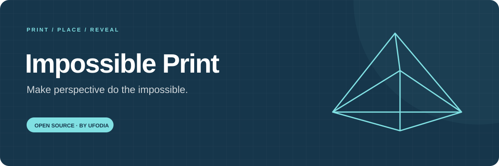
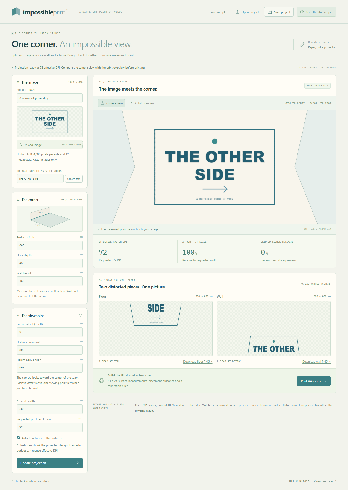

<p align="center">
  
</p>

# Impossible Print

[](LICENSE)
[](docs/privacy.md)

**Make a picture that only comes together from one place.** Turn local artwork into two distorted prints for a right-angle wall and tabletop. Mark the viewing point, place the paper, and let perspective reconnect the image.

[First installation](docs/guide.md) · [Projection explained](docs/architecture.md) · [Reference](docs/reference.md) · [Contribute](CONTRIBUTING.md)

<p>
  <a href="https://buymeacoffee.com/ufodia"></a>
</p>



## An ordinary corner, seen differently

A flat image looks simple until you split it across two perpendicular surfaces. Impossible Print computes the distortion for a measured viewing point, previews the result on a real 3D corner, and prepares numbered print sheets you can assemble yourself.

Use it for a surprising desk installation, an exhibition experiment, a classroom perspective demonstration or a small piece of physical art. Start with the original **THE OTHER SIDE** sample, create text in the studio, or bring a PNG, JPEG or WebP image.

| Bring                               | Measure                                            | Explore                                                | Make                                                |
| ----------------------------------- | -------------------------------------------------- | ------------------------------------------------------ | --------------------------------------------------- |
| Local raster artwork or a few words | Surface sizes and the viewing point in millimetres | Reconstructed camera view and draggable orbit overview | Two warped PNGs and an actual-size A4 assembly plan |

The studio processes images in your browser. It does not request your camera, scan a room or upload your artwork.

## Try the studio locally

Install **Node.js 24 LTS** and Git, then run:

```sh
git clone https://github.com/ufodia/impossible-print.git
cd impossible-print
npm ci
npm run dev
```

Open the local address printed by Vite. Wait for **Projection ready**, switch between **Camera view** and **Orbit overview**, then change **Lateral offset (+ left)** to see the printable distortion change. Return to **Camera view** to inspect the reconstruction.

On Windows, use `npm.cmd` if PowerShell blocks the npm script launcher. Follow the [first-installation guide](docs/guide.md) before committing paper to a physical corner.

## What you can make in 0.1.0

- Load the original sample, create text artwork or import a local raster image.
- Set wall width, floor depth, wall height and a three-coordinate viewing point.
- Generate actual inverse-rasterized floor and wall images.
- Shrink the artwork automatically to fit the measured surfaces, or inspect estimated clipping with auto-fit off.
- Compare a perspective reconstruction with an orbit view of the two distorted surfaces.
- Save and reopen a project containing its source image and measurements.
- Download each warped surface as a PNG.
- Open an A4 assembly plan with a setup diagram, numbered tiles and a 100 mm calibration ruler.

The same generated rasters power the 2D previews, the Three.js scene and the print plan. If WebGL is unavailable, the 2D previews and printing remain usable.

## From pixels to paper

The supported installation is a **flat, true 90° corner**. The artwork is centred on the seam and the virtual camera aims at its centre. Positive lateral offset means left when you face the wall. Keep the printed floor's top edge against the printed wall's bottom edge; neither surface should be mirrored.

Print at **100% / Actual size** on A4 portrait paper with 10 mm margins. Disable browser headers and footers, then measure the calibration line before assembling. Raw PNG files contain pixels; the assembly plan supplies the physical millimetre scale.

Physical results depend on paper alignment, printer scaling, surface flatness, measurements and lens distortion. Automated geometry and browser checks do not establish the accuracy of your particular printed installation. [The guide](docs/guide.md) covers placement and troubleshooting.

## Deliberate boundaries

| Boundary   | Current behaviour                                                                                             |
| ---------- | ------------------------------------------------------------------------------------------------------------- |
| Corner     | One wall and one floor/tabletop at 90°; no arbitrary room geometry                                            |
| Viewpoint  | A manually measured point aimed at the seam centre; no camera calibration or live capture                     |
| Source     | PNG, JPEG or WebP; at most 8 MiB, 4,096 pixels per side and 12 megapixels                                     |
| Output     | At most 6 megapixels across both surfaces and 4,096 pixels per side; effective DPI can fall below the request |
| Print plan | A4 portrait, 190 × 267 mm artwork tiles, at most 120 surface tiles plus one setup sheet                       |
| Clipping   | An estimate from 48 × 48 samples of source-image area, rather than a physical quality score                   |

SVG, remote image URLs, curved surfaces and automatic printer/lens correction are outside this version. See the [schema and limits](docs/reference.md).

## Reproduce the checks

```sh
npm run verify
npx playwright install --no-shell chromium
npm run test:e2e
```

`verify` runs strict TypeScript, unit tests and the production build. The browser suite exercises real changing raster outputs, WebGL camera/orbit rendering, project round trips, print geometry, malformed imports and the WebGL fallback. The [testing guide](docs/testing.md) explains the remaining physical checks.

## Find your way around

| You want to…                                  | Start here                           |
| --------------------------------------------- | ------------------------------------ |
| Build and place your first illusion           | [User guide](docs/guide.md)          |
| Understand the projection and raster pipeline | [Architecture](docs/architecture.md) |
| Inspect schema, bounds and core functions     | [Reference](docs/reference.md)       |
| Understand what is stored or shared           | [Privacy](docs/privacy.md)           |
| Verify a change                               | [Testing](docs/testing.md)           |
| Restore a computer from source                | [Restoration](docs/restore.md)       |
| Host the static studio                        | [Deployment](docs/deployment.md)     |

## Keep another point of view available

If the studio helps you make something worth showing, a coffee supports browser compatibility work, geometry regressions and clearer print instructions. Support is voluntary; the same open-source tool remains available to everyone.

[Buy ufodia a coffee](https://buymeacoffee.com/ufodia) · [Contribute a reproducible improvement](CONTRIBUTING.md)

First-party code and artwork: **MIT © 2026 ufodia**. Three.js retains its own MIT notice; see [third-party notices](THIRD_PARTY_NOTICES.md).
